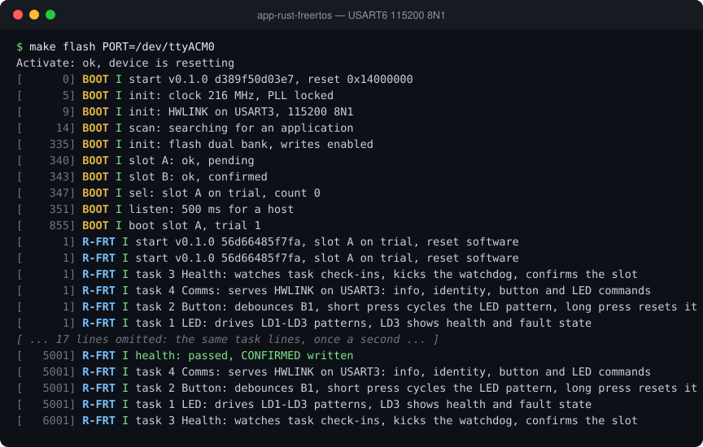

# app-rust-freertos

The NUCLEO-F767ZI demo application written in Rust (`no_std`, no allocator)
running directly on the FreeRTOS kernel. It runs under the A/B bootloader from
either slot and does the same job as the C FreeRTOS demo: LED patterns, the
user button, HWLINK communication with the desktop GUI, watchdog supervision
and self-confirmation after a health check. The C side keeps the proven board
start-up, STM32 HAL drivers, FreeRTOS task creation and bootloader contract;
all application logic is Rust. A CMake build compiles both and links the Rust
staticlib after the C objects into one image.

## Debug terminal

The debug log from a reset on a NUCLEO-F767ZI (USART6, 115200 8N1), recorded from the board. [Watch it replay line by line](https://soccentric-stm32.github.io/#rust-freertos) on the project page.



<details>
<summary>Plain text</summary>

```console
$ make flash PORT=/dev/ttyACM0
Activate: ok, device is resetting
[      0] BOOT I start v0.1.0 d389f50d03e7, reset 0x14000000
[      5] BOOT I init: clock 216 MHz, PLL locked
[      9] BOOT I init: HWLINK on USART3, 115200 8N1
[     14] BOOT I scan: searching for an application
[    335] BOOT I init: flash dual bank, writes enabled
[    340] BOOT I slot A: ok, pending
[    343] BOOT I slot B: ok, confirmed
[    347] BOOT I sel: slot A on trial, count 0
[    351] BOOT I listen: 500 ms for a host
[    855] BOOT I boot slot A, trial 1
[      1] R-FRT I start v0.1.0 56d66485f7fa, slot A on trial, reset software
[      1] R-FRT I start v0.1.0 56d66485f7fa, slot A on trial, reset software
[      1] R-FRT I task 3 Health: watches task check-ins, kicks the watchdog, confirms the slot
[      1] R-FRT I task 4 Comms: serves HWLINK on USART3: info, identity, button and LED commands
[      1] R-FRT I task 2 Button: debounces B1, short press cycles the LED pattern, long press resets it
[      1] R-FRT I task 1 LED: drives LD1-LD3 patterns, LD3 shows health and fault state
[ ... 17 lines omitted: the same task lines, once a second ... ]
[   5001] R-FRT I health: passed, CONFIRMED written
[   5001] R-FRT I task 4 Comms: serves HWLINK on USART3: info, identity, button and LED commands
[   5001] R-FRT I task 2 Button: debounces B1, short press cycles the LED pattern, long press resets it
[   5001] R-FRT I task 1 LED: drives LD1-LD3 patterns, LD3 shows health and fault state
[   6001] R-FRT I task 3 Health: watches task check-ins, kicks the watchdog, confirms the slot
```

</details>

## Features

- Application logic in Rust (`no_std`, no heap allocator) on the FreeRTOS kernel
- C platform layer for GPIO, USART3, IWDG, time, fault record and CONFIRMED flash
- Runs from either bootloader slot, linked at `0x0800C000`
- Four FreeRTOS tasks: Health, Comms, Button and LED, created before the scheduler starts
- Health task supervises 500 ms check-ins and is the only watchdog feeder
- Seven LED patterns on LD1/LD2 with LD3 reserved for faults
- B1 button with EXTI wake-up, 30 ms software debounce and short/long press actions
- HWLINK over USART3 with COBS framing, CRC-32 and a verified FlatBuffers codec
- Commands: Hello, Ping, GetStatus, SetLed, SetLedAll, ClearFault, SetBaud, Reset and EnterBootloader
- Unsolicited ButtonEvent messages and replay of the last reply on a repeated sequence number
- SetBaud to 921600 with automatic fallback to 115200
- CONFIRMED record written after a successful trial health check
- Fail-health build option to test bootloader rollback
- Reset cause and a no-init fault record with CFSR, HFSR, MMFAR, BFAR, PC and LR
- Rust panics, FreeRTOS asserts and stack overflows take the same fault path
- Task stack high-water marks reported in the status reply
- Build fails if the image exceeds 128 KB flash or 64 KB RAM
- Produces a ready-to-flash bootloader image (`rust-freertos-app.img`)
- Reproducible Docker build environment with the pinned Rust toolchain

> Hardware bench validation of this port is still pending. The build, link,
> boot-contract and image checks run in CI.

## Project layout

```
src/                Rust application crate (`no_std`, no allocator)
  app/              FreeRTOS tasks (health, comms, button, LED), IPC and services
  platform/         Rust FFI surface, board/boot constants, build metadata
  protocol/         HWLINK COBS/CRC-32 framing and fixed-buffer FlatBuffers codec
platform/           C platform layer (STM32 HAL and FreeRTOS live outside it)
  boot/             Bootloader contract, hand-over record, CONFIRMED record
  drivers/          Clock, USART3, IWDG, cache/MPU, CRC-32, reset cause, timebase
  fault/            No-init fault record shared with Rust
  log/              USART6 debug log
  rtos/             FreeRTOS hooks (assert, stack overflow, malloc failure)
include/            rust_app.h: entry points exported by the Rust staticlib
board/              NUCLEO-F767ZI pin mapping and FreeRTOS/HAL configuration
ld/                 app.ld: slot at 0x0800C000, no-init fault window, DMA window
protocol/           Shared HWLINK FlatBuffers schema
scripts/            build, Docker, image and footprint helpers
docker/             stm32-dev-rust-freertos image on top of the shared stm32-dev base
ci/                 Jenkins release packaging and version helpers
docs/               Architecture notes and the build pipeline
CMakeLists.txt      Mixed C/Rust build: HAL, FreeRTOS, Cargo staticlib, ELF/image
Makefile            build, lint, fmt, flash, debug and serial targets
```

## Documentation

- [docs/architecture.md](docs/architecture.md) — layers, boot flow and where code goes
- [protocol/README.md](protocol/README.md) — HWLINK schema and framing
- [docker/README.md](docker/README.md) — build container and toolchain

## Build and run

```bash
scripts/docker-dev.sh build   # build the stm32-dev-rust-freertos image once
scripts/build.sh              # configure + build the C platform and Rust app
make flash                    # upload build/rust-freertos-app.img through BOOT
make serial                   # ST-LINK VCP console, 115200 8N1
make help                     # list all targets
```

`make` (or `make build`) configures CMake and builds the firmware. CMake
compiles the C platform, HAL and FreeRTOS kernel, then invokes Cargo for the
Rust staticlib and links it into `build/rust-freertos-app.elf`. The build also
writes `.bin`, `.hex`, `.map` and the bootloader `.img`, and checks the 128 KB
flash / 64 KB RAM budget.

Useful targets: `make lint` (clang-tidy over the C sources), `make fmt`
(cargo fmt in the container), `make size`, `make probe`, `make gdbserver`,
`make debug` and `make erase-all`.

## Related projects

- [bootloader](https://github.com/soccentric-stm32/bootloader) — A/B bootloader with UART update, CRC32 checks, trial boot and rollback
- [app-c-freertos](https://github.com/soccentric-stm32/app-c-freertos) — Demo application in C on FreeRTOS
- [app-c-zephyr](https://github.com/soccentric-stm32/app-c-zephyr) — Demo application in C on Zephyr RTOS
- [app-rust-freertos](https://github.com/soccentric-stm32/app-rust-freertos) — Demo application in Rust on FreeRTOS (this repository)
- [app-rust-embassy](https://github.com/soccentric-stm32/app-rust-embassy) — Demo application in Rust on Embassy
- [app-rust-zephyr](https://github.com/soccentric-stm32/app-rust-zephyr) — Demo application in Rust on Zephyr RTOS
- [validation-firmware](https://github.com/soccentric-stm32/validation-firmware) — HWVAL hardware validation firmware
- [validation-gui](https://github.com/soccentric-stm32/validation-gui) — HWVAL Studio: desktop GUI for tests, updates and flashing
- [factory-station](https://github.com/soccentric-stm32/factory-station) — HWVAL Factory: end-of-line test and provisioning station
- [soccentric-stm32.github.io](https://github.com/soccentric-stm32/soccentric-stm32.github.io) — Project website

## License

Released under the [MIT License](LICENSE) © 2026 Sandesh Ghimire. You are free
to use, modify and ship it in your own products.

Contributions are welcome. Fork the repository, make your change on a branch and
open a pull request. Bug reports, ideas and improvements are all appreciated.
